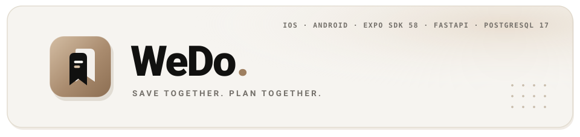
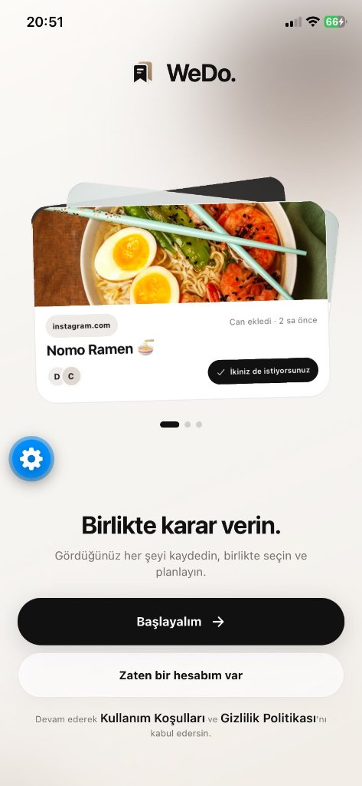
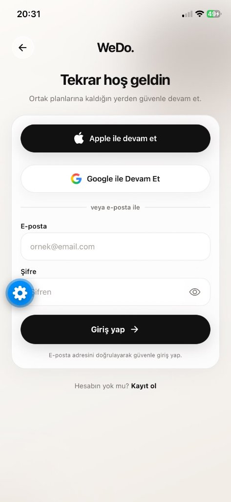
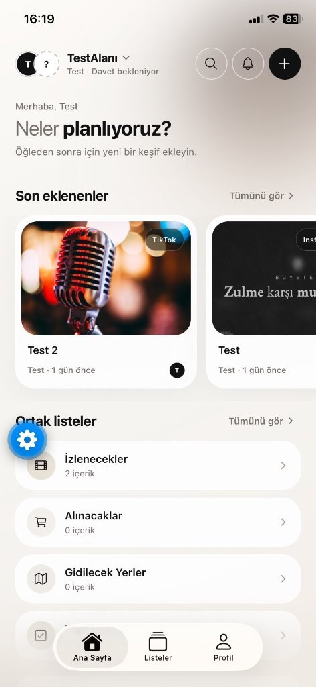
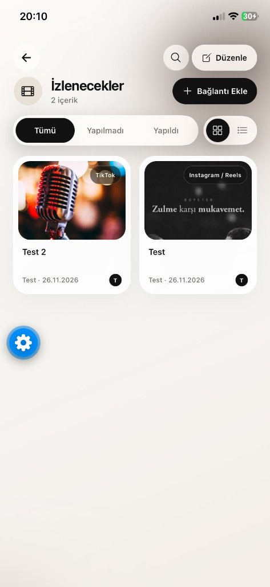
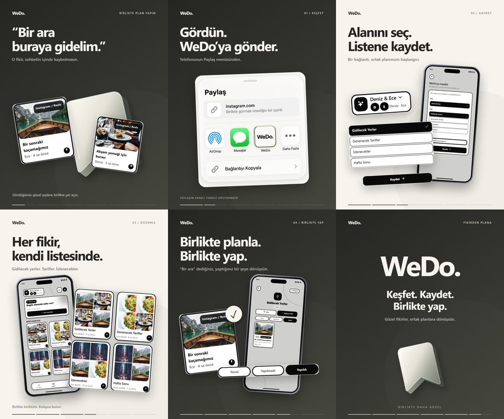
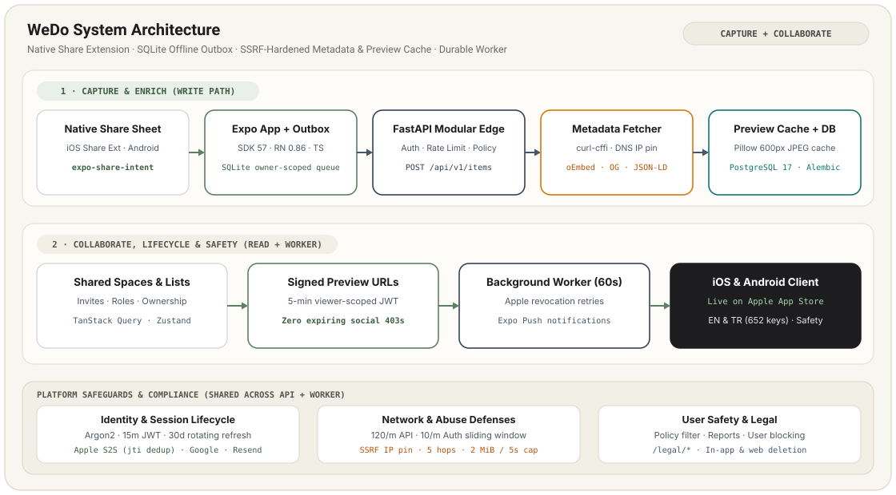

<div align="center">

<br />



<br />
<br />

**Save links and ideas from any app into shared spaces, discuss and organize them together, and turn inspiration into scheduled real-world plans.**

<p>
  <a href="https://apps.apple.com/us/app/wedo-save-together/id6823755849"><strong>App Store</strong></a> ·
  <a href="#why-wedo">Why WeDo</a> ·
  <a href="#what-is-new--brand--ui-redesign">What's New</a> ·
  <a href="#see-it-in-action">Gallery</a> ·
  <a href="#architecture--tech-stack">Architecture</a> ·
  <a href="#engineering-decisions">Design Choices</a> ·
  <a href="#quickstart">Quickstart</a> ·
  <a href="#api-reference">API</a> ·
  <a href="#security-privacy--scope">Security &amp; Scope</a> ·
  <a href="README.tr.md">Türkçe</a>
</p>

<p>
  <sub>
    <code>iOS App Store</code> ·
    <code>Expo SDK 58</code> ·
    <code>React Native 0.88</code> ·
    <code>FastAPI</code> ·
    <code>PostgreSQL 17</code> ·
    <code>SQLite Outbox</code> ·
    <code>EN / TR (761 keys)</code> ·
    <code>264 Tests (166 Py + 98 Jest)</code>
  </sub>
</p>

</div>

---

## Brand Identity & Visual System

WeDo pairs a tactile **Warm Alabaster (`#F6F4F0`)** canvas with **Warm Bronze (`#9E7F60`)**, sculpted translucent glass controls, and a custom **Paired Bookmark Ribbon** identity:

<div align="center">
  <table>
    <tr>
      <td align="center" width="220">
        
        <br /><sub><strong>App Icon</strong> — Warm Bronze &amp; Ink Paired Ribbon</sub>
      </td>
      <td align="center" width="460">
        
        <br /><sub><strong>Editorial Wordmark</strong> — Animated Splash &amp; Auth Shell</sub>
      </td>
    </tr>
  </table>
</div>

---

## Why WeDo?

Great ideas shared between partners and friends rarely live in one place—they get buried across messaging threads, browser tabs, and forgotten bookmarks. Saving a reel, restaurant, product, or movie straight from another mobile app takes more than CRUD endpoints behind a list view: share extensions must survive unreliable mobile networks, social preview thumbnails expire within hours, fetching arbitrary user URLs opens SSRF vectors, and turning saved links into real meetups requires calm planning, calendar deep linking, and App Store-grade identity and safety engineering.

**WeDo** is a mobile-first shared decision and planning platform—live on the **[Apple App Store](https://apps.apple.com/us/app/wedo-save-together/id6823755849)**—designed as a modular monolith backend paired with a native-integrated Expo client and durable offline capture.

### What Is New & Core Capabilities

* **Warm Alabaster UI, Tactile Motion & Haptics:** Redesigned screens with a breathable ambient glow canvas, consistent translucent Liquid Glass icon buttons across tab switches, calm eased sheet entrances, configurable `expo-haptics` feedback (`HapticsToggle`), customizable list icons & warm color swatches, and persisted list reordering.
* **Calm Date Planning & Calendar Deep Links:** Schedule saved items directly as active plans (`PlanSheet` with localized Turkish/English month names and `15m / 1h / 1d` reminders — no approval bottleneck), manage every plan uniformly via `PlanCard` across Home, the dedicated **Plans** view in Lists, and Item Details (inline rescheduling via `PATCH /api/v1/plans/{id}`, complete, or cancel), open venues in Apple or Google Maps, and save **`WeDo plan`** calendar events that deep-link directly back to `/item/{id}`.
* **WhatsApp-Style Notes, Comments & Activity Feed:** Discuss saved links in a two-sided conversational chat (`ItemCommentsSection` with day dividers, grouped sender bubbles, and tap-to-edit/delete own messages), edit titles and notes cleanly, track unread notifications directly on the `SpaceHeaderBar` bell badge, and inspect unified item, comment, and plan events in the activity timeline.
* **Fast Discovery, Swipe Actions & Offline Outbox:** Search every list from a bottom modal sheet (`/search`), sort (`Newest`, `Oldest`, `A–Z`) and filter by source (`Instagram`, `TikTok`, `YouTube`, `Shopping`, `Maps`, `Web`), switch smoothly between Grid and swipe-enabled Row cards with **Undo** toasts (`AppToast`), detect URLs from the iOS/Android clipboard, cache fast previews with `expo-image`, invite partners with scannable QR codes (`InviteQrSheet`), and monitor queued shares via `OutboxStatusBanner`.
* **Native Share-to-Save & SSRF-Hardened Thumbnails:** Capture links from the iOS Share Extension (`WeDoShare` App Group) and Android Share Intents into an `owner_id`-scoped `expo-sqlite` outbox; extract rich previews via DNS-pinned `curl-cffi` and persist expiring social CDN images behind short-lived viewer-scoped signed URLs.
* **Multi-Provider Auth & Safety Governance:** Supports Argon2 email/password with Resend verification, Sign in with Apple (including verified S2S notifications and background revocation), Google Sign-In, one-tap account deletion, abuse reporting, and atomic space isolation on user blocks.

---

## See it in action

<div align="center">
  <table>
    <tr>
      <td align="center" width="25%">
        
        <br /><sub><strong>Welcome Deck</strong></sub>
      </td>
      <td align="center" width="25%">
        
        <br /><sub><strong>Sign In</strong></sub>
      </td>
      <td align="center" width="25%">
        
        <br /><sub><strong>Home Space</strong></sub>
      </td>
      <td align="center" width="25%">
        
        <br /><sub><strong>List Collection</strong></sub>
      </td>
    </tr>
  </table>
</div>

### End-to-End Flow

<div align="center">
  
</div>

1. **Discover & Capture:** Save links from Instagram, TikTok, YouTube, Maps, or Safari via the native Share Sheet or automatic clipboard detection.
2. **Organize & Discuss:** Group links into custom icon-and-color lists, leave comments inline, filter by platform, and mark items done or move them with swipe gestures.
3. **Schedule & Sync to Calendar:** Pick a date and time cleanly, adjust, complete, or cancel plans directly from Home, Lists → Plans, or Item Details, and tap calendar events to jump right back to the planned item inside WeDo.

*(Production ships with full English and Turkish parity across `766` synchronized localization keys and `974` checked UI call sites.)*

---

## Architecture & Tech Stack

<div align="center">
  
</div>

WeDo cleanly separates mobile capture and metadata enrichment (**Write Path**) from collaborative browsing, planning workflows, durable account lifecycle jobs, and push notifications (**Read & Worker Path**):

* **1. Capture & Enrich (Write Path):**
  `Native Share Sheet` → `Expo App + SQLite Outbox` → `FastAPI Modular Edge` → `Metadata Fetcher` → `Preview Cache + PostgreSQL 17`
  Incoming URLs and text land in an `owner_id`-partitioned `expo-sqlite` outbox before reaching `POST /api/v1/items`. The backend validates safety policies, runs SSRF-hardened metadata extraction (`curl-cffi` + `oEmbed` / `Open Graph` / `JSON-LD`), and persists expiring social CDN images as `600×600` Pillow JPEGs in PostgreSQL.

* **2. Collaborate, Plan & Lifecycle (Read & Worker Path):**
  `Spaces, Plans & Comments` → `Signed Preview URLs` → `Background Worker (60s)` → `iOS & Android Client`
  Members browse spaces, chat inline on saved items, schedule and reschedule shared plans, sync deep-linked events into iOS/Google Calendar, load private thumbnails via 5-minute viewer-scoped JWT URLs, and rely on the background worker for plan reminder notifications, Expo Push dispatch, and Apple token revocations.

### Stack Breakdown

| Layer | Choice | Why It Is Here |
| :--- | :--- | :--- |
| **Mobile & Web Client** | Expo SDK 58 · React Native 0.88 · React 19.3 · TypeScript 6.0 | Typed Expo Router navigation across iOS, Android, and web with `Zustand` and `TanStack Query` |
| **Native Capabilities** | `expo-share-intent` · `expo-sqlite` · `expo-calendar` · `expo-haptics` · `expo-image` · `expo-clipboard` | `WeDoShare` iOS Share Extension (App Group), offline outbox, device calendar deep links, haptics, cached previews, and smart clipboard detection |
| **Localization** | `i18next` · `react-i18next` · `expo-localization` · `LanguageMiddleware` | End-to-end TR/EN parity across `766` mobile keys and backend catalogs with native TR/EN date/month formatting |
| **API Core** | FastAPI · Pydantic Settings · SQLAlchemy 2 · Alembic (`18` migrations) | Modular monolith separating `auth`, `users`, `spaces`, `invitations`, `members`, `lists`, `items`, `comments`, `plans`, `activities`, `notifications`, and `safety` |
| **Metadata & Imaging** | `curl-cffi` · `BeautifulSoup4` · `Pillow` | Browser TLS impersonation, HTML/oEmbed parsing, and `600×600` JPEG thumbnail caching |
| **Persistence & Worker** | PostgreSQL 17 · Python Background Worker (`app.worker`) | ACID relational state, cached preview binaries, plan reminders, Apple revocation retries, and push dispatch |
| **Auth, Delivery & Ops** | Apple Sign-In · Google Sign-In · Resend · Docker · Railway | Verified social auth, transactional verification/moderation emails, CI check suites, and container deployment |

---

## Engineering Decisions

| Problem | Solution | Practical Impact |
| :--- | :--- | :--- |
| **Social CDN thumbnails expiring after save (`cdninstagram.com`, `tiktokcdn.com`, `fbcdn.net`)** | Detected expiring hosts/flags, resized images via Pillow (`600×600` JPEG q=`82`) into PostgreSQL (`ItemPreviewImage`), and served them via `/api/v1/items/{id}/preview?token=...` with 5-minute viewer-scoped JWTs (`Cache-Control: private, no-store`) | **Zero broken `403`/`410` social previews** while keeping cached media private to space members |
| **SSRF, DNS rebinding & bot blocks on untrusted user links** | Enforced HTTP/HTTPS scheme & port allowlists (`80`, `443`, `8080`, `8443`), verified public IPs across up to `5` redirects, pinned sockets via `CurlOpt.RESOLVE`, capped reads (`2 MiB` / `5s`), and used `curl-cffi` TLS impersonation + `oEmbed` | Defends internal services against DNS rebinding and SSRF while maximizing metadata extraction reliability |
| **iOS Liquid Glass buttons turning opaque white across `NativeTabs` switches** | Replaced volatile UIKit backdrop sampling on tab header circular buttons (`IconButton`) and `SegmentedControl` with deterministic layered `LinearGradient` + hairline rim overlays over `AmbientBackground` | Preserves the frosted translucent glass look identically on cold launch and after tab switches |
| **Calendar entries losing context back to saved items** | Stored short clean calendar event titles (`WeDo plan` / `WeDo planı`) paired with Expo Router deep links (`url` field on iOS EventKit + clickable hint URL) pointing to `/item/{itemId}` | Keeps device calendars uncluttered while opening the exact planned item in WeDo in one tap |
| **Lost shares & jarring view toggles on mobile** | Persisted shares inside an `owner_id`-partitioned `expo-sqlite` outbox with visible `OutboxStatusBanner` retry UI; moved `ListDetail` headers outside keyed `FlatList` and replaced bouncy springs with `ENTER_EASING` | Prevents data loss offline and eliminates full-screen header flicker when switching between Grid and swipe-Row views |
| **Cross-platform TR/EN localization drift** | Verified `766` translation keys (`974` calls) via `frontend/scripts/check-locales.cjs` plus deterministic Turkish/English month/weekday arrays independent of OS ICU settings | Prevents missing keys and guarantees Turkish month names on Turkish iOS/Android pickers |

---

## Quickstart

### 1. Clone & Configure `.env`

```bash
git clone https://github.com/DuranGZR/WeDo.git
cd WeDo
cp backend/.env.example backend/.env
cp frontend/.env.example frontend/.env
```

For local development, default database credentials (`postgresql+psycopg://wedo:wedo@db:5432/wedo` in Docker or `localhost:5432` natively) and development JWT settings work out of the box. External provider credentials (`APPLE_*`, `GOOGLE_*`, `RESEND_API_KEY`) are only needed when testing Apple/Google Sign-In or live verification/moderation emails.

### 2. Start Backend & Worker (`Docker Compose`)

[`backend/compose.yml`](backend/compose.yml) launches PostgreSQL 17, runs `alembic upgrade head`, starts FastAPI, and boots the background `worker`:

```bash
cd backend
docker compose up --build
```

Healthy local endpoints:
* **FastAPI Server:** [http://localhost:8000](http://localhost:8000)
* **Interactive OpenAPI / Swagger Docs:** [http://localhost:8000/docs](http://localhost:8000/docs)
* **Liveness & Readiness Probes:** [http://localhost:8000/health](http://localhost:8000/health) · [http://localhost:8000/health/ready](http://localhost:8000/health/ready)

### 3. Run the Expo Client

```bash
cd frontend
pnpm install
pnpm start
```

Set `EXPO_PUBLIC_API_URL` in `frontend/.env` to `http://localhost:8000` for simulators/web, or to your machine's LAN IP (`http://<YOUR_LAN_IP>:8000`) / deployed API URL when running on a physical iOS or Android device.

<details>
<summary><strong>Local backend without Docker (<code>uv</code>) &amp; containerized web preview</strong></summary>

#### Run Backend Natively with `uv`

Requires PostgreSQL 17 matching `DATABASE_URL` in `backend/.env`:

```bash
cd backend
uv sync --dev
uv run alembic upgrade head

# Terminal 1 — FastAPI API
uv run uvicorn app.main:app --reload

# Terminal 2 — Background Worker (Plan reminders + Apple revocations + Expo push dispatch)
uv run python -m app.worker
```

#### Containerized Web Preview (`compose.yml`)

The root [`compose.yml`](compose.yml) builds the static Expo web bundle served behind Nginx at `http://127.0.0.1:8081`:

```bash
docker compose up --build
```

</details>

---

## API Reference

Authenticated endpoints use `Authorization: Bearer <access_token>` (`15`-minute JWT paired with `30`-day rotating refresh tokens). Interactive OpenAPI docs (`/docs`, `/redoc`, `/openapi.json`) are enabled in development and automatically disabled when `ENVIRONMENT=production`.

| Route Group | Rate Limit / Auth | Purpose |
| :--- | :---: | :--- |
| `GET /health`, `/health/ready` | Public | Liveness probe and PostgreSQL readiness check |
| `/api/v1/auth/*` | `10 / min` on mutations | Email sign-up/verification/sign-in, Apple & Google sign-in + linking, Apple S2S webhook, token refresh rotation, sign-out/all, password change |
| `/api/v1/users/me` | Bearer JWT | Authenticated profile read/update and in-app account deletion |
| `/api/v1/spaces/*` & `.../members/*` | Bearer JWT | Shared space CRUD, member list/profiles, role updates/ownership transfer, and leaving a space |
| `/api/v1/invitations/*` & `GET /invite/{token}` | Bearer JWT / Public HTML | Space invitation creation, QR deep-link URLs, acceptance, and mobile landing page (`wedo://invite/{token}`) |
| `/api/v1/lists/*` & `.../spaces/{id}/lists` | Bearer JWT | Shared list CRUD, custom icon/color tokens, and persisted list ordering (`/api/v1/lists/reorder`) |
| `/api/v1/items/*` & `.../lists/{id}/items` | Bearer JWT / Signed JWT | Link/text creation, metadata enrichment, note/title editing, move, complete/restore, activity feed (`/items/{id}/activity`), and signed preview serving (`/items/{id}/preview`) |
| `/api/v1/items/{id}/comments` & `/api/v1/comments/*` | Bearer JWT | Item discussion comments CRUD with safety checks, push dispatch, and activity logging |
| `/api/v1/spaces/{id}/plans` & `/api/v1/plans/*` | Bearer JWT | Immediate shared date scheduling, reminder offsets, inline rescheduling (`PATCH /plans/{id}`), and `complete` / `cancel` transitions |
| `/api/v1/notifications/*` & `/api/v1/devices/*` | Bearer JWT | Notification inbox, unread count, mark-read, and Expo push device registration |
| `/api/v1/safety/*` | Bearer JWT | Content/user reporting (`POST /safety/reports`) and user blocking (`GET/PUT/DELETE /safety/blocks`) |
| `/legal/*`, `/privacy`, `/terms`, `/delete-account` | Public (`10 / min` POST) | Hosted privacy policy, terms of service, and web account-deletion request intake (`202 Accepted`) |

---

## Quality Gates & Project Layout

GitHub Actions ([`backend-quality.yml`](.github/workflows/backend-quality.yml) and [`frontend-quality.yml`](.github/workflows/frontend-quality.yml)) verify formatting, linting, static types, localization parity, and all `265` automated tests (`166` backend + `99` frontend):

```bash
# Backend format, lint & test suite (166 pytest tests)
cd backend
uv sync --dev --locked
uv run ruff format --check app tests
uv run ruff check .
uv run pytest

# Frontend format, typecheck, lint, localization parity (766 keys / 974 calls) & Jest suite (22 suites / 99 tests)
cd frontend
pnpm install --frozen-lockfile
pnpm exec prettier --check "jest.setup.ts" "src/**/*.{ts,tsx}" "src/i18n/resources/*.json"
pnpm exec tsc --noEmit
pnpm exec eslint .
pnpm run i18n:check
pnpm test
```

<details>
<summary><strong>Repository Directory Tree</strong></summary>

```text
WeDo/
├── .github/workflows/
│   ├── backend-quality.yml       # Ruff + Pytest CI pipeline
│   └── frontend-quality.yml      # TypeScript + ESLint + Jest CI pipeline
├── backend/
│   ├── app/
│   │   ├── api/                  # Shared dependencies & v1 API router registration
│   │   ├── core/                 # Settings, rate limiter, Request-ID, localization & mail
│   │   ├── db/                   # SQLAlchemy 2 session, models & URL validation
│   │   ├── locales/              # Backend EN/TR message catalogs
│   │   ├── modules/              # Auth (Apple/Google/Email), spaces, invitations, lists, items, comments, plans, activities, metadata, notifications, safety, users, legal
│   │   ├── application.py        # FastAPI factory & lifespan revocation/reminder loops
│   │   ├── main.py               # ASGI entry point
│   │   └── worker.py             # 60s background worker (Apple revocations, reminders & push delivery)
│   ├── migrations/               # 18 Alembic schema migrations (0001..0018)
│   ├── tests/                    # 166 isolated pytest tests (auth, SSRF, previews, plans, comments, safety)
│   ├── compose.yml               # Local API + Worker + PostgreSQL 17 stack
│   └── pyproject.toml            # Python 3.13 + Ruff + Pytest configuration
├── frontend/
│   ├── assets/                   # App icons, paired ribbon marks, ambient glow & splash assets
│   ├── locales/                  # Native iOS/Android InfoPlist & Share Extension locales
│   ├── plugins/                  # Expo config plugins for Share Extension & localization
│   ├── scripts/                  # Locale key-parity validator (check-locales.cjs)
│   ├── src/
│   │   ├── app/                  # Expo Router screens ((auth), (onboarding), (share), (tabs), search, item, list, space, settings, legal)
│   │   ├── database/             # SQLite client & owner-scoped offline sharing outbox
│   │   ├── design-system/        # Warm Alabaster tokens, shadows, typography & UI primitives
│   │   ├── features/             # Domain APIs, PlanSheet, PlanCard, UpcomingPlansSection, QR invite & ShareIntentNavigator
│   │   ├── i18n/                 # Synchronized EN/TR catalogs (766 keys) & native calendar date formatters
│   │   ├── lib/                  # Calendar/Maps deep-linking helpers & Expo haptics wrappers
│   │   ├── store/                # Zustand auth, selected-space & haptic preference state
│   │   └── __tests__/            # 22 Jest test suites (99 tests)
│   ├── app.config.ts             # Expo SDK 58 app & native plugin manifest
│   └── package.json              # RN 0.88.1, React 19.3, TS 6.0 & scripts
├── docs/
│   ├── images/                   # Brand marks, hero SVG, architecture SVG, storyboard & app screenshots
│   └── legal/                    # Published Privacy Policy, Terms & Account Deletion guides
└── compose.yml                   # Nginx-served Expo web preview container
```

</details>

---

## Security, Privacy & Scope

* **Passwords & Token Lifecycle:** Passwords use Argon2 hashing (`pwdlib[argon2]`); access tokens expire in `15` minutes and `30`-day refresh tokens are stored as SHA-256 hashes and rotated on every refresh. Apple refresh tokens stored for account-deletion revocation are encrypted at rest with Fernet.
* **Bounded Sliding-Window Rate Limiting:** In-memory sliding-window middleware enforces `120 req/min` globally and `10 req/min` per IP+route on authentication and web deletion endpoints, respecting forwarded headers only from configured trusted proxies and bounding memory at `10,000` tracked buckets.
* **SSRF & Content Guards:** Link metadata fetching rejects private/loopback/link-local IPs across redirect chains, pins DNS resolution directly into `libcurl`, limits payload sizes (`2 MiB`) and timeouts (`5s`), and screens user/item/comment/plan inputs against configurable blocked terms and domains.
* **Legal & Account Deletion:** Public policies and deletion flows live in [`PRIVACY_POLICY.md`](docs/legal/PRIVACY_POLICY.md), [`TERMS_OF_SERVICE.md`](docs/legal/TERMS_OF_SERVICE.md), and [`ACCOUNT_DELETION.md`](docs/legal/ACCOUNT_DELETION.md).
* **Scope Boundaries:** Link preview richness depends on metadata exposed publicly by source platforms without login or anti-bot walls. Legacy reaction/memory/upload endpoints (`reactions`, `memories`, `uploads`) remain unmounted from the public router and explicitly guarded by [`test_excluded_features.py`](backend/tests/test_excluded_features.py) and [`test_collaboration.py`](backend/tests/test_collaboration.py).
