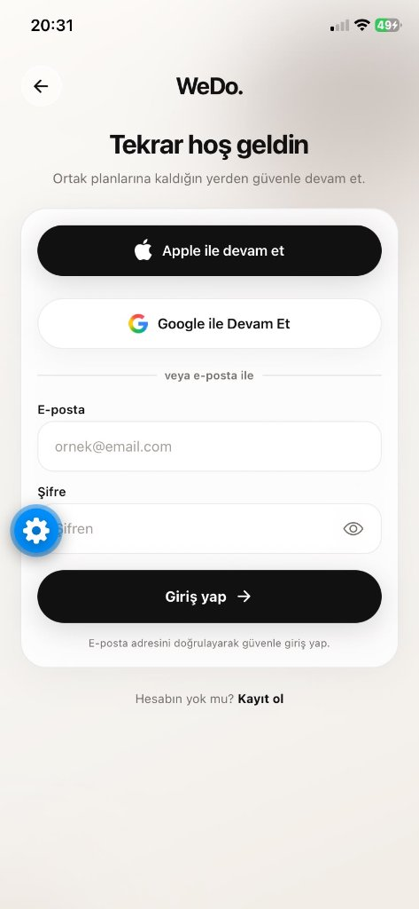

<div align="center">

<br />


<br />
<br />

**Herhangi bir uygulamadan gördüğün bağlantıları ve fikirleri ortak alanlara kaydet, birlikte tartışıp düzenle ve ilhamları gerçek planlara dönüştür.**

<p>
  <a href="https://apps.apple.com/us/app/wedo-save-together/id6823755849"><strong>App Store</strong></a> ·
  <a href="#neden-wedo">Neden WeDo</a> ·
  <a href="#yenilikler-ve-temel-yetenekler">Yenilikler</a> ·
  <a href="#uygulama-ekranları-ve-akış">Görseller</a> ·
  <a href="#mimari-ve-teknoloji-yığını">Mimari</a> ·
  <a href="#mühendislik-kararları">Mühendislik Kararları</a> ·
  <a href="#hızlı-kurulum">Kurulum</a> ·
  <a href="#api-referansı">API</a> ·
  <a href="#güvenlik-gizlilik-ve-kapsam">Güvenlik ve Gizlilik</a> ·
  <a href="README.md">English</a>
</p>

<p>
  <sub>
    <code>iOS App Store</code> ·
    <code>Expo SDK 58</code> ·
    <code>React Native 0.88</code> ·
    <code>FastAPI</code> ·
    <code>PostgreSQL 17</code> ·
    <code>SQLite Outbox</code> ·
    <code>TR / EN (761 anahtar)</code> ·
    <code>264 Test (166 Py + 98 Jest)</code>
  </sub>
</p>

</div>

---

## Marka Kimliği ve Görsel Sistem

WeDo, sıcak **Warm Alabaster (`#F6F4F0`)** zeminini **Warm Bronze (`#9E7F60`)** vurgular, yarı saydam cam denetimler ve yeni **Çift Yer İmi Kurdelesi (Paired Bookmark Ribbon)** logosuyla birleştirir:

<div align="center">
  <table>
    <tr>
      <td align="center" width="220">
        
        <br /><sub><strong>Uygulama İkonu</strong> — Bronz Zemin &amp; Çift Kurdele</sub>
      </td>
      <td align="center" width="460">
        
        <br /><sub><strong>Marka Logosu</strong> — Açılış ve Giriş Ekranları</sub>
      </td>
    </tr>
  </table>
</div>

---

## Neden WeDo?

Çiftlerin ve arkadaş gruplarının paylaştığı güzel fikirler çoğu zaman mesaj geçmişinde, açık sekmelerde veya ekran görüntülerinde kaybolur. Instagram, TikTok, Safari ya da harita uygulamalarından gelen bir bağlantıyı gerçek bir buluşmaya dönüştürmek sıradan bir yer imi tablosundan fazlasını gerektirir: mobil paylaşım eklentisi zayıf bağlantılarda veri kaybetmemeli, sosyal medya önizleme görselleri birkaç saat sonra kırılmamalı, kullanıcıların gönderdiği linkler SSRF açığına yol açmamalı ve App Store'da yayınlanan çok kullanıcılı bir ürün gerçek hesap yaşam döngüsü, gizlilik, takvim deep-link ve moderasyon altyapısına sahip olmalıdır.

**WeDo**, **[Apple App Store](https://apps.apple.com/us/app/wedo-save-together/id6823755849)** üzerinde yayında olan; modüler monolith FastAPI backend'i, native paylaşım ve takvim entegrasyonlu Expo istemcisi ve kalıcı çevrimdışı kuyruk mimarisiyle tasarlanmış mobil öncelikli bir ortak karar ve planlama platformudur.

### Yenilikler ve Temel Yetenekler

* **Warm Alabaster Arayüz, Haptics & Sade Hareket Dili:** Hareketli bronz ortam parıltısı üzerinde sekme geçişlerinde rengini koruyan yarı saydam cam butonlar, sadeleştirilmiş animasyonlar, Ayarlar'dan yönetilebilen `expo-haptics` dokunsal geri bildirimi (`HapticsToggle`), özelleştirilebilir liste ikon/renk seçenekleri ve kalıcı liste sıralama.
* **Ortak Tarih Planlama & Takvim Deep-Link Entegrasyonu:** Etkileşimli çark (`spinner`) tarih/saat seçicisi (`PlanSheet` — Türkçe ay ve gün adlarıyla), `15 dk / 1 sa / 1 gün` hatırlatıcıları, partner onay/ret/iptal akışı, **Listeler** ekranındaki özel **Planlar** sekmesinden anında tarih/saat düzenleme (`PATCH /api/v1/plans/{id}`), Apple/Google Maps mekân açma ve **`WeDo planı`** başlığıyla kaydedilip takvimden tıklandığında ilgili içeriği doğrudan WeDo içinde açan takvim etkinlikleri.
* **Öğe Notları, Yorumlar & Birleşik Aktivite Geçmişi:** İçerik detayının altında satır içi tartışma kartları (`ItemCommentsSection`), başlık/açıklama düzenleme (`PATCH /api/v1/items/{id}`), üst çubuktaki bildirim zilinde okunmamış sayısı rozeti (`SpaceHeaderBar`) ve içerik/yorum/plan geçmişini tek akışta gösteren aktivite ekranı.
* **Hızlı Keşif, Kaydırma Aksiyonları & Çevrimdışı Görünürlük:** Alttan açılan modal pencereyle tüm alanda arama (`/search`), liste içi sıralama (`En yeni`, `En eski`, `A–Z`) ve kaynak filtresi (`Instagram`, `TikTok`, `YouTube`, `Alışveriş`, `Harita`, `Web`), başlığı zıplatmadan değişen Izgara/Liste görünümü, **Geri Al (Undo)** toast destekli sağa/sola kaydırma aksiyonları, akıllı pano (Clipboard) link önerisi, `expo-image` önbellekli görsel shimmer'ı, QR kod ile tek dokunuşla davet (`InviteQrSheet`) ve canlı `OutboxStatusBanner` senkronizasyon çubuğu.
* **Native Paylaşarak Kaydetme ve SSRF Korumalı Önizlemeler:** iOS Share Extension (`WeDoShare`, App Group) ve Android Share Intent üzerinden gelen linkleri kullanıcıya izole (`owner_id`) `expo-sqlite` outbox'ına yazar; DNS IP sabitlemeli `curl-cffi` istekleriyle önizleme çeker ve süresi dolan sosyal medya CDN görsellerini yeniden boyutlandırıp kısa ömürlü imzalı URL'lerle servis eder.
* **Çoklu Kimlik Doğrulama & Güvenlik Kontrolleri:** Argon2 parola hashleme ve Resend e-posta doğrulaması, Apple Sign-In (S2S bildirimler + arka plan token iptali), Google Sign-In, tek dokunuşla hesap silme, içerik/kullanıcı şikâyetleri ve kullanıcı engellemede atomik alan izolasyonu sunar.

---

## Uygulama Ekranları ve Akış

<div align="center">
  <table>
    <tr>
      <td align="center" width="25%">
        
        <br /><sub><strong>Karşılama Ekranı</strong></sub>
      </td>
      <td align="center" width="25%">
        
        <br /><sub><strong>Giriş Ekranı</strong></sub>
      </td>
      <td align="center" width="25%">
        
        <br /><sub><strong>Ana Sayfa</strong></sub>
      </td>
      <td align="center" width="25%">
        
        <br /><sub><strong>Liste Koleksiyonu</strong></sub>
      </td>
    </tr>
  </table>
</div>

### Uçtan Uca Kullanım Döngüsü

<div align="center">
  
</div>

1. **Keşfet ve Kaydet:** Instagram, TikTok, YouTube, Haritalar veya tarayıcıdan Paylaş menüsü ya da pano algılama ile bağlantıları saniyeler içinde listene kaydet.
2. **Düzenle ve Tartış:** Kayıtları özel ikonlu ortak listelerde topla, içerik altına not/yorum bırak, platforma göre filtrele ve kaydırma hareketleriyle işaretle.
3. **Planla ve Takvime Bağla:** Birlikte gün ve saat belirle, Listeler → Planlar sekmesinden tarihleri düzenle ve cihaz takvimindeki etkinlikten tek dokunuşla WeDo içindeki içeriğe dön.

*(Uygulama, CI doğrulamalı `761` senkronize anahtar ve `1.000` kontrol edilen çağrı ile tam Türkçe ve İngilizce dil eşdeğerliğine sahiptir.)*

---

## Mimari ve Teknoloji Yığını

<div align="center">
  
</div>

WeDo, mobil içerik yakalama ve zenginleştirme hattını (**Write Path**) ortak listeleme, planlama akışları, hesap yaşam döngüsü işleri ve bildirim dağıtımından (**Read & Worker Path**) net biçimde ayırır:

* **1. Yakalama ve Zenginleştirme (Write Path):**
  `Native Share Sheet` → `Expo App + SQLite Outbox` → `FastAPI Modular Edge` → `Metadata Fetcher` → `Preview Cache + PostgreSQL 17`
  iOS Share Extension veya Android Intent üzerinden gelen bağlantılar önce kullanıcıya izole `expo-sqlite` outbox kuyruğuna alınır, ardından `POST /api/v1/items` ile sunucuya iletilir. Backend politika kontrollerini çalıştırır, SSRF korumalı metadata çıkarıcıyı (`curl-cffi` + `oEmbed` / `Open Graph` / `JSON-LD`) işletir ve süresi dolan sosyal medya görsellerini `600×600` Pillow JPEG olarak PostgreSQL'e kaydeder.

* **2. Ortak Çalışma, Planlama ve Arka Plan İşleri (Read & Worker Path):**
  `Spaces, Plans & Comments` → `Signed Preview URLs` → `Background Worker (60s)` → `iOS & Android Client`
  Üyeler listeleri yönetir, içeriklere yorum yazar, buluşma planı önerir ve düzenler, cihaz takvimine deep-link ekler, imzalı URL'lerle önizlemeleri yükler; `60` saniyelik arka plan worker'ı ise plan hatırlatmalarını, Apple token iptallerini ve Expo Push bildirimlerini işler.

### Teknoloji Yığını

| Katman | Tercih | Neden Bu Seçim |
| :--- | :--- | :--- |
| **Mobil ve Web İstemci** | Expo SDK 58 · React Native 0.88 · React 19.3 · TypeScript 6.0 | iOS, Android ve web üzerinde tip güvenli Expo Router navigasyonu, `Zustand` ve `TanStack Query` |
| **Native Yetenekler** | `expo-share-intent` · `expo-sqlite` · `expo-calendar` · `expo-haptics` · `expo-image` · `expo-clipboard` | `WeDoShare` iOS Share Extension (App Group), SQLite outbox, takvim deep-link, dokunsal titreşim, önbellekli görseller ve akıllı pano yakalama |
| **Yerelleştirme** | `i18next` · `react-i18next` · `expo-localization` · `LanguageMiddleware` | CI'da doğrulanan `761` mobil anahtar, backend mesajları ve yerli Türkçe ay/gün biçimlendirme |
| **API Çekirdeği** | FastAPI · Pydantic Settings · SQLAlchemy 2 · Alembic (`18` migration) | `auth`, `users`, `spaces`, `invitations`, `members`, `lists`, `items`, `comments`, `plans`, `activities`, `notifications` ve `safety` modüllerini ayıran modüler monolith |
| **Metadata ve Görsel İşleme** | `curl-cffi` · `BeautifulSoup4` · `Pillow` | Tarayıcı TLS taklidi, HTML/oEmbed ayrıştırma ve `600×600` JPEG önizleme sıkıştırma |
| **Veri ve Arka Plan İşleri** | PostgreSQL 17 · Python Background Worker (`app.worker`) | ACID veri bütünlüğü, önbellekli görseller, plan hatırlatma kuyruğu, Apple iptal döngüsü ve push gönderimi |
| **Kimlik, E-posta ve Dağıtım** | Apple Sign-In · Google Sign-In · Resend · Docker · Railway | Doğrulanmış sosyal giriş, doğrulama/moderasyon e-postaları, CI kontrolü ve konteyner dağıtımı |

---

## Mühendislik Kararları

| Problem | Çözüm | Pratik Etki |
| :--- | :--- | :--- |
| **Sosyal medya CDN görsellerinin süre sonunda kırılması (`cdninstagram.com`, `tiktokcdn.com`, `fbcdn.net`)** | Süresi dolan host/parametreler tespit edilir; Pillow ile (`600×600` JPEG, kalite `82`) PostgreSQL'e (`ItemPreviewImage`) kaydedilir ve 5 dk ömürlü kullanıcıya özel JWT ile (`Cache-Control: private, no-store`) sunulur | Zamanla oluşan `403`/`410` kırık görselleri engeller; görselleri yalnızca yetkili alan üyelerine açar |
| **Kullanıcı bağlantılarında SSRF, DNS rebinding ve bot koruması riski** | HTTP/HTTPS ve standart port (`80`, `443`, `8080`, `8443`) kısıtı uygulanır; en fazla `5` yönlendirmeye kadar genel IP doğrulanır, IP `CurlOpt.RESOLVE` ile sabitlenir, `2 MiB` / `5 sn` sınırı konur | İç ağa sızma ve DNS rebinding saldırılarını önlerken yüksek metadata başarı oranı sunar |
| **iOS `NativeTabs` geçişlerinde Liquid Glass butonların beyaza dönmesi** | Sekme üst çubuğundaki dairesel `IconButton` ve `SegmentedControl` bileşenlerinde değişken UIKit backdrop örneklemesi yerine deterministik katmanlı `LinearGradient` + ince beyaz kenarlık uygulandı | İlk açılışta ve tüm sekme geçişlerinde aynı yarı saydam cam görünümünü korur |
| **Takvim etkinliklerinden uygulamadaki plana dönüş** | Takvime yalnızca temiz `WeDo planı` başlığı yazılır; iOS EventKit `url` alanı ve not bağlantısı olarak doğrudan `/item/{itemId}` rotasına giden deep-link eklenir | Telefon takvimini kalabalıklaştırmaz; etkinlikten tek dokunuşla ilgili içeriği açar |
| **Zayıf ağlarda paylaşım kaybı ve görünüm geçişinde ekran zıplaması** | Paylaşımlar kullanıcıya özel `expo-sqlite` outbox kuyruğunda tutulup `OutboxStatusBanner` ile izlenir; liste başlığı `FlatList` dışına alınarak Grid/Liste geçişinde sabit bırakıldı | Çevrimdışı paylaşımları korur ve görünüm değişiminde başlık/filtre titremesini sıfırlar |
| **TR/EN çeviri ve tarih biçimlerinin kayması** | `frontend/scripts/check-locales.cjs` ile `761` anahtar (`1.000` çağrı) CI'da doğrulanır; ay/gün adları işletim sistemi ICU ayarından bağımsız biçimlendirilir | Eksik çeviri anahtarı oluşmaz; Türkçe ekranda aylar her cihazda eksiksiz Türkçe görünür |

---

## Hızlı Kurulum

### 1. Repoyu Klonla ve `.env` Dosyalarını Hazırla

```bash
git clone https://github.com/DuranGZR/WeDo.git
cd WeDo
cp backend/.env.example backend/.env
cp frontend/.env.example frontend/.env
```

Yerel geliştirmede varsayılan veritabanı ayarları ve geliştirme JWT anahtarları doğrudan çalışır. Harici servis anahtarları (`APPLE_*`, `GOOGLE_*`, `RESEND_API_KEY`) yalnızca Apple/Google girişini veya canlı e-postaları test ederken gereklidir.

### 2. Backend ve Worker'ı Başlat (`Docker Compose`)

[`backend/compose.yml`](backend/compose.yml) PostgreSQL 17'yi başlatır, `alembic upgrade head` migration'larını uygular, FastAPI API'sini ve arka plan `worker` servisini ayağa kaldırır:

```bash
cd backend
docker compose up --build
```

Sağlıklı yerel uç noktalar:
* **FastAPI Sunucusu:** [http://localhost:8000](http://localhost:8000)
* **Etkileşimli OpenAPI / Swagger Dokümantasyonu:** [http://localhost:8000/docs](http://localhost:8000/docs)
* **Canlılık ve Hazırlık Kontrolleri:** [http://localhost:8000/health](http://localhost:8000/health) · [http://localhost:8000/health/ready](http://localhost:8000/health/ready)

### 3. Expo İstemcisini Çalıştır

```bash
cd frontend
pnpm install
pnpm start
```

Simülatör/web için `frontend/.env` içinde `EXPO_PUBLIC_API_URL=http://localhost:8000`, fiziksel cihazlar için yerel ağ IP adresini (`http://<YEREL_IP>:8000`) veya canlı sunucu adresini kullan.

<details>
<summary><strong>Docker olmadan yerel backend (<code>uv</code>) ve konteynerli web önizlemesi</strong></summary>

#### Backend'i Doğrudan `uv` ile Çalıştırma

```bash
cd backend
uv sync --dev
uv run alembic upgrade head

# Terminal 1 — FastAPI API
uv run uvicorn app.main:app --reload

# Terminal 2 — Arka Plan Worker (Plan hatırlatıcıları + Apple iptali + Expo push)
uv run python -m app.worker
```

#### Konteynerli Web Önizlemesi (`compose.yml`)

```bash
docker compose up --build
```

</details>

---

## API Referansı

Kimlik doğrulama gerektiren uç noktalar `Authorization: Bearer <access_token>` başlığını kullanır (`15` dk access token + `30` gün dönen refresh token).

| Uç Nokta Grubu | Oran Sınırı / Yetki | Amaç |
| :--- | :---: | :--- |
| `GET /health`, `/health/ready` | Herkese açık | API canlılık ve PostgreSQL bağlantı kontrolü |
| `/api/v1/auth/*` | Mutasyonlarda `10 / dk` | E-posta kayıt/doğrulama/giriş, Apple ve Google giriş, Apple S2S webhook, token yenileme rotasyonu, çıkış ve şifre değişikliği |
| `/api/v1/users/me` | Bearer JWT | Kullanıcı profili okuma/güncelleme ve uygulama içi hesap silme |
| `/api/v1/spaces/*` ve `.../members/*` | Bearer JWT | Ortak alan CRUD, üye profilleri, rol güncelleme / sahiplik devri ve alandan ayrılma |
| `/api/v1/invitations/*` ve `GET /invite/{token}` | Bearer JWT / Herkese açık HTML | Alan daveti, QR deep-link URL'i, kabul etme ve mobil yönlendirme sayfası (`wedo://invite/{token}`) |
| `/api/v1/lists/*` ve `.../spaces/{id}/lists` | Bearer JWT | Ortak liste CRUD, ikon/renk özelleştirme ve kalıcı liste sıralama (`/api/v1/lists/reorder`) |
| `/api/v1/items/*` ve `.../lists/{id}/items` | Bearer JWT / İmzalı JWT | Bağlantı ekleme, metadata çekme, başlık/not düzenleme, liste taşıma, tamamlama/geri alma, aktivite geçmişi (`/items/{id}/activity`) ve imzalı önizleme sunumu (`/items/{id}/preview`) |
| `/api/v1/items/{id}/comments` ve `/api/v1/comments/*` | Bearer JWT | İçerik altı yorum ve not CRUD akışı, güvenlik kontrolü ve bildirim dağıtımı |
| `/api/v1/spaces/{id}/plans` ve `/api/v1/plans/*` | Bearer JWT | Ortak tarih planlama, hatırlatıcılar, plan güncelleme (`PATCH /plans/{id}`) ve `approve` / `reject` / `cancel` / `complete` geçişleri |
| `/api/v1/notifications/*` ve `/api/v1/devices/*` | Bearer JWT | Bildirim kutusu, okunmamış rozet sayacı, okundu işaretleme ve Expo push kaydı |
| `/api/v1/safety/*` | Bearer JWT | İçerik/kullanıcı bildirimi (`POST /safety/reports`) ve engellenen kullanıcılar (`GET/PUT/DELETE /safety/blocks`) |
| `/legal/*`, `/privacy`, `/terms`, `/delete-account` | Herkese açık (`POST` için `10 / dk`) | Gizlilik politikası, kullanım koşulları ve web hesap silme talebi (`202 Accepted`) |

---

## Kalite Kapıları ve Proje Yapısı

GitHub Actions ([`backend-quality.yml`](.github/workflows/backend-quality.yml) ve [`frontend-quality.yml`](.github/workflows/frontend-quality.yml)) tüm `264` otomatik testi (`166` backend + `98` frontend), statik tip kontrollerini ve çeviri bütünlüğünü doğrular:

```bash
# Backend format, lint ve test paketi (166 pytest testi)
cd backend
uv sync --dev --locked
uv run ruff format --check app tests
uv run ruff check .
uv run pytest

# Frontend format, tip kontrolü, lint, çeviri (761 anahtar / 1.000 çağrı) ve Jest (22 suite / 98 test)
cd frontend
pnpm install --frozen-lockfile
pnpm exec prettier --check "jest.setup.ts" "src/**/*.{ts,tsx}" "src/i18n/resources/*.json"
pnpm exec tsc --noEmit
pnpm exec eslint .
pnpm run i18n:check
pnpm test
```

<details>
<summary><strong>Depo Dizin Ağacı</strong></summary>

```text
WeDo/
├── .github/workflows/
│   ├── backend-quality.yml       # Ruff + Pytest CI hattı
│   └── frontend-quality.yml      # TypeScript + ESLint + Jest CI hattı
├── backend/
│   ├── app/
│   │   ├── api/                  # Ortak bağımlılıklar ve v1 API router kaydı
│   │   ├── core/                 # Ayarlar, hız sınırlama, Request-ID, yerelleştirme ve e-posta
│   │   ├── db/                   # SQLAlchemy 2 oturumu, modeller ve URL doğrulama
│   │   ├── locales/              # Backend TR/EN mesaj katalogları
│   │   ├── modules/              # Auth, spaces, invitations, lists, items, comments, plans, activities, metadata, notifications, safety, users, legal
│   │   ├── application.py        # FastAPI fabrika fonksiyonu ve lifespan döngüleri
│   │   ├── main.py               # ASGI giriş noktası
│   │   └── worker.py             # 60 sn döngülü worker (hatırlatıcılar, Apple iptalleri + push)
│   ├── migrations/               # 18 Alembic veritabanı migration dosyası (0001..0018)
│   ├── tests/                    # 166 izole pytest testi
│   ├── compose.yml               # Yerel API + Worker + PostgreSQL 17 yığını
│   └── pyproject.toml            # Python 3.13 + Ruff + Pytest ayarları
├── frontend/
│   ├── assets/                   # Uygulama ikonları, çift kurdele logoları ve ortam parıltıları
│   ├── locales/                  # Native iOS/Android InfoPlist ve Share Extension çevirileri
│   ├── plugins/                  # Share Extension ve yerelleştirme için Expo eklentileri
│   ├── scripts/                  # Çeviri anahtar tutarlılığı doğrulayıcı (check-locales.cjs)
│   ├── src/
│   │   ├── app/                  # Expo Router ekranları ((auth), (onboarding), (share), (tabs), search, item, list, space, settings, legal)
│   │   ├── database/             # SQLite istemcisi ve kullanıcıya izole outbox
│   │   ├── design-system/        # Warm Alabaster token'ları, gölgeler, tipografi ve UI bileşenleri
│   │   ├── features/             # Domain API'leri, PlanSheet, UpcomingPlansSection, QR davet & paylaşım
│   │   ├── i18n/                 # Senkronize TR/EN katalogları (761 anahtar) ve yerli tarih biçimleyiciler
│   │   ├── lib/                  # Takvim/Harita deep-link ve Haptics yardımcıları
│   │   ├── store/                # Zustand oturum, seçili alan ve haptics tercihi
│   │   └── __tests__/            # 22 Jest test paketi (98 test)
│   ├── app.config.ts             # Expo SDK 58 uygulama ve native eklenti manifestosu
│   └── package.json              # RN 0.88.1, React 19.3, TS 6.0 ve betikler
├── docs/
│   ├── images/                   # Marka logoları, hero/mimari SVG, storyboard ve ürün ekranları
│   └── legal/                    # Gizlilik Politikası, Kullanım Koşulları ve Hesap Silme rehberi
└── compose.yml                   # Nginx ile servis edilen Expo web önizleme konteyneri
```

</details>

---

## Güvenlik, Gizlilik ve Kapsam

* **Parola ve Token Güvenliği:** Parolalar Argon2 ile (`pwdlib[argon2]`) hashlenir; `15` dakikalık access token'lar kısa ömürlü tutulur, `30` günlük refresh token'lar SHA-256 özetiyle saklanır ve her yenilemede rotasyona uğrar. Hesap silme iptalleri için tutulan Apple refresh token'ları Fernet ile şifrelenir.
* **Sınırlı Kayan Pencere Oran Sınırlaması:** Bellek içi middleware genel API trafiğinde `120 istek/dk`, kimlik doğrulama ve web hesap silme uç noktalarında IP+rota başına `10 istek/dk` uygular; yalnızca güvenilir proxy başlıklarını dikkate alır.
* **SSRF ve İçerik Korumaları:** Bağlantı önizleme çekimleri yönlendirme zinciri boyunca özel/loopback/link-local IP'leri reddeder, DNS çözümlemesini `libcurl` içine sabitler, yanıt boyutunu (`2 MiB`) ve zaman aşımını (`5 sn`) sınırlar ve kullanıcı/içerik/yorum/plan girdilerini engelli kelime ve alan adı politikalarından geçirir.
* **Yasal Dokümanlar ve Kapsam Sınırları:** Gizlilik, kullanım koşulları ve hesap silme süreçleri [`PRIVACY_POLICY.md`](docs/legal/PRIVACY_POLICY.md), [`TERMS_OF_SERVICE.md`](docs/legal/TERMS_OF_SERVICE.md) ve [`ACCOUNT_DELETION.md`](docs/legal/ACCOUNT_DELETION.md) belgelerinde yer alır. Eski `reactions`, `memories` ve `uploads` uç noktaları genel router'da kapalı tutulur ve [`test_excluded_features.py`](backend/tests/test_excluded_features.py) ile [`test_collaboration.py`](backend/tests/test_collaboration.py) tarafından korunur.
