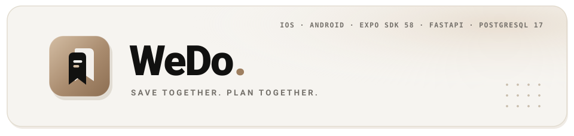
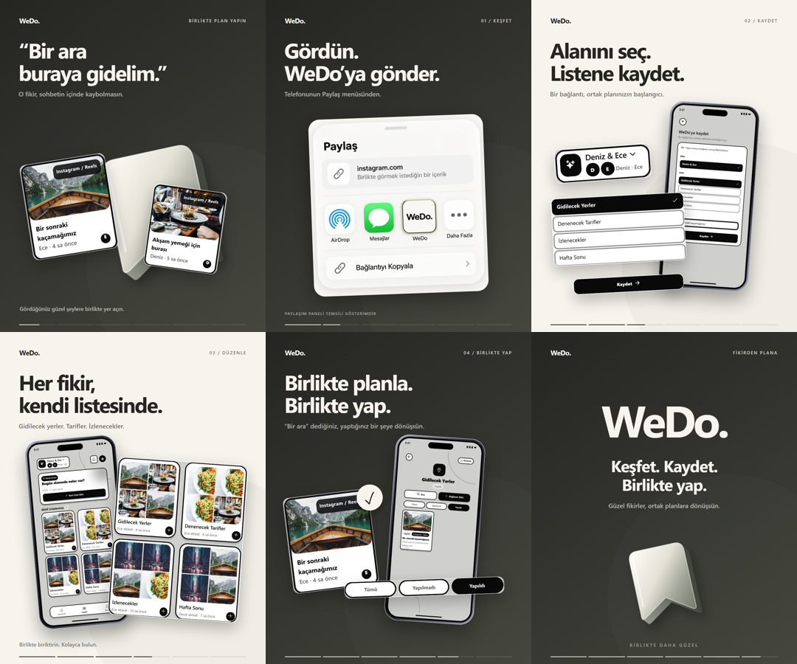
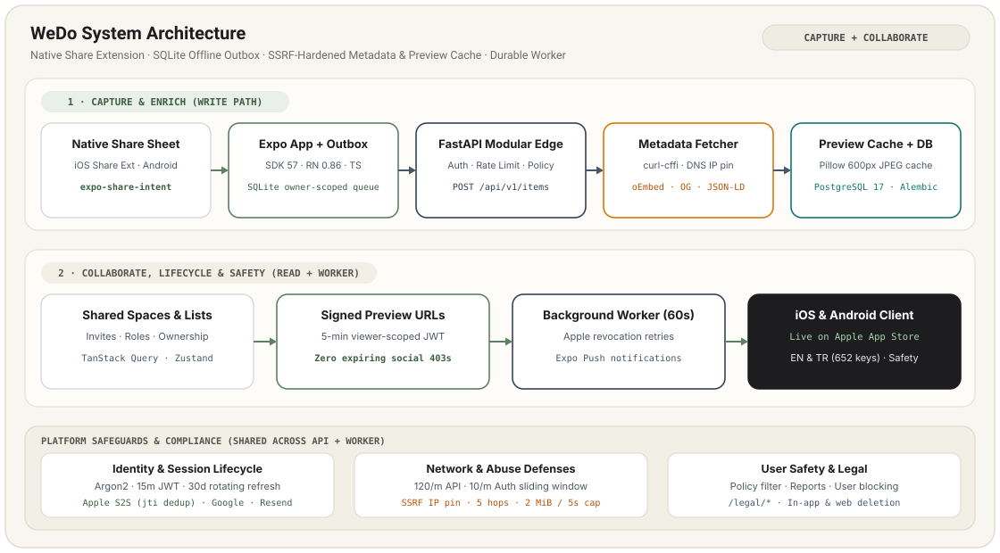

<div align="center">

<br />



<br />
<br />

**Herhangi bir uygulamadan gördüğün bağlantıları ve fikirleri ortak alanlara kaydet, listelerde birlikte düzenle ve ilhamları gerçek planlara dönüştür.**

<p>
  <a href="https://apps.apple.com/us/app/wedo-save-together/id6823755849"><strong>App Store</strong></a> ·
  <a href="#neden-wedo">Neden WeDo</a> ·
  <a href="#uygulama-akışı">Uygulama Akışı</a> ·
  <a href="#mimari-ve-teknoloji-yığını">Mimari</a> ·
  <a href="#mühendislik-kararları">Mühendislik Kararları</a> ·
  <a href="#hızlı-kurulum">Kurulum</a> ·
  <a href="#api-referansı">API</a> ·
  <a href="#güvenlik-gizlilik-ve-kapsam">Güvenlik ve Gizlilik</a> ·
  <a href="README.md">English</a>
</p>

<p>
  <sub>
    <code>iOS App Store</code> ·
    <code>Expo SDK 57</code> ·
    <code>React Native 0.86</code> ·
    <code>FastAPI</code> ·
    <code>PostgreSQL 17</code> ·
    <code>SQLite Outbox</code> ·
    <code>TR / EN (652 anahtar)</code> ·
    <code>232 Test (166 Py + 66 Jest)</code>
  </sub>
</p>

</div>

---

## Neden WeDo?

Çiftlerin ve arkadaş gruplarının paylaştığı güzel fikirler çoğu zaman mesaj geçmişinde, açık sekmelerde veya ekran görüntülerinde kaybolur. Instagram, TikTok, Safari ya da bir alışveriş uygulamasından gelen bağlantıyı ortak bir karara dönüştürmek sıradan bir yer imi tablosundan fazlasını gerektirir: mobil paylaşım eklentisi zayıf bağlantılarda veri kaybetmemeli, sosyal medya önizleme görselleri birkaç saat sonra kırılmamalı, kullanıcıların gönderdiği linkleri sunucuda çözmek SSRF açığına dönüşmemeli ve App Store'da yayınlanan çok kullanıcılı bir ürün gerçek hesap yaşam döngüsü, gizlilik ve moderasyon altyapısına sahip olmalıdır.

**WeDo**, **[Apple App Store](https://apps.apple.com/us/app/wedo-save-together/id6823755849)** üzerinde yayında olan; modüler monolith FastAPI backend'i, native paylaşım entegrasyonlu Expo istemcisi ve kalıcı çevrimdışı kuyruk mimarisiyle tasarlanmış mobil öncelikli bir ortak karar ve planlama platformudur.

### Temel Yetenekler

* **Native Paylaşarak Kaydetme ve Çevrimdışı Outbox:** iOS Share Extension (`WeDoShare`, App Group üzerinden) ve Android Share Intent aracılığıyla gelen bağlantı ve metinleri kullanıcıya izole (`owner_id`) `expo-sqlite` outbox kuyruğuna yazarak bağlantı kesintilerinde bile kaybı önler.
* **SSRF Korumalı Akıllı Önizleme ve Kalıcı Görsel Önbelleği:** DNS IP sabitlemeli `curl-cffi` istekleriyle `Open Graph`, `Twitter Card`, `JSON-LD` ve YouTube/TikTok `oEmbed` verilerini çözer; süresi dolan sosyal medya CDN görsellerini (`Instagram`, `Facebook`, `TikTok`) yeniden boyutlandırıp kalıcı olarak depolar ve kısa ömürlü imzalı URL'lerle servis eder.
* **Ortak Alanlar, Listeler ve Alan Yönetimi:** Partnerin, arkadaşların veya farklı planlar için ayrı ortak alanlar oluştur; mobil deep-link davetleriyle (`/invite/{token}`) üye ekle; özel sıralanabilir listeler yönet, içerikleri ara/filtrele, listeler arasında taşı, tamamlandı olarak işaretle ve alandan ayrılmadan önce sahipliği güvenle devret.
* **Çoklu Kimlik Doğrulama ve Tam Hesap Yaşam Döngüsü:** Argon2 parola hashleme ve Resend e-posta doğrulaması, native Sign in with Apple (doğrulanmış S2S bildirimleri ve kalıcı arka plan token iptali dahil) ve doğrulanmış Google Sign-In desteğinin yanında uygulama içi ve web üzerinden hesap silme akışı sunar.
* **Dahili Güvenlik Kontrolleri ve Çift Dil Bütünlüğü:** İçerik ve alan adı politika filtresi, Resend bildirimli kalıcı şikâyet kayıtları, engelleme anında ortak alan erişimini kesen kullanıcı engelleme mekanizması ve CI'da `652` anahtar (`802` kullanım noktası) üzerinden doğrulanan eksiksiz Türkçe/İngilizce desteği içerir.

---

## Uygulama Akışı

Aşağıdaki altı adımlı görsel akış, bir fikrin sohbette görülmesinden telefonun Paylaş menüsüyle WeDo'ya düşmesine, ortak listelerde düzenlenmesine ve birlikte hayata geçirilmesine kadar tüm deneyimi özetler:

<div align="center">
  
</div>

1. **Keşfet (`01`):** Sohbette geçen bir öneri ya da mekân fikri mesajların arasında kaybolmaz.
2. **Paylaş (`02`):** Telefonun yerel Paylaş menüsünden **WeDo**'yu seç, ortak alanını ve listeni belirleyip tek dokunuşla kaydet.
3. **Düzenle (`03`):** Zengin önizlemeli kartlar kimin ne zaman eklediği bilgisiyle birlikte `Gidilecek Yerler`, `Denenecek Tarifler`, `İzlenecekler` ve `Hafta Sonu` gibi listelerde toplanır.
4. **Birlikte Yap (`04`):** `Tümü`, `Yapılmadı` ve `Yapıldı` filtreleriyle karar sürecini takip et, orijinal bağlantıya tek dokunuşla dön ve planları gerçeğe dönüştür.

---

## Mimari ve Teknoloji Yığını

<div align="center">
  
</div>

WeDo, mobil içerik yakalama ve zenginleştirme hattını (**Write Path**) ortak listeleme, hesap yaşam döngüsü işleri ve bildirim dağıtımından (**Read & Worker Path**) net biçimde ayırır:

* **1. Yakalama ve Zenginleştirme (Write Path):**
  `Native Share Sheet` → `Expo App + SQLite Outbox` → `FastAPI Modular Edge` → `Metadata Fetcher` → `Preview Cache + PostgreSQL 17`
  iOS Share Extension veya Android Intent üzerinden gelen bağlantılar önce kullanıcıya izole `expo-sqlite` outbox kuyruğuna alınır, ardından `POST /api/v1/items` ile sunucuya iletilir. Backend politika kontrollerini çalıştırır, SSRF korumalı metadata çıkarıcıyı (`curl-cffi` + `oEmbed` / `Open Graph` / `JSON-LD`) işletir ve süresi dolan sosyal medya görsellerini `600×600` Pillow JPEG olarak PostgreSQL'e kaydeder.

* **2. Ortak Çalışma, Yaşam Döngüsü ve Güvenlik (Read & Worker Path):**
  `Shared Spaces & Lists` → `Signed Preview URLs` → `Background Worker (60s)` → `iOS & Android Client`
  Üyeler `TanStack Query` ve `Zustand` ile güncellenen listeleri görüntüler; önbelleğe alınan görselleri 5 dakikalık kullanıcıya özel JWT imzalı URL'ler üzerinden yükler. `60` saniyelik arka plan worker'ı (yalnızca API çalıştıran ortamlarda FastAPI lifespan döngüsüyle desteklenir) Apple token iptallerini ve Expo Push bildirimlerini kalıcı olarak işler.

### Teknoloji Yığını

| Katman | Tercih | Neden Bu Seçim |
| :--- | :--- | :--- |
| **Mobil ve Web İstemci** | Expo SDK 57 · React Native 0.86 · React 19.2 · TypeScript 6 | iOS, Android ve web üzerinde tip güvenli Expo Router navigasyonu, `Zustand` ve `TanStack Query` |
| **Native Yetenekler** | `expo-share-intent` · `expo-sqlite` · `expo-secure-store` · `expo-notifications` | Özel `WeDoShare` iOS Share Extension (App Group), Android intent filtreleri, güvenli token saklama ve SQLite outbox |
| **Yerelleştirme** | `i18next` · `react-i18next` · `expo-localization` · `LanguageMiddleware` | CI'da doğrulanan `652` mobil anahtar ve backend hata/durum mesajlarıyla tam TR/EN uyumu |
| **API Çekirdeği** | FastAPI · Pydantic Settings · SQLAlchemy 2 · Alembic (`19` migration) | `auth`, `users`, `spaces`, `invitations`, `members`, `lists`, `items`, `notifications` ve `safety` modüllerini ayıran modüler monolith |
| **Metadata ve Görsel İşleme** | `curl-cffi` · `BeautifulSoup4` · `Pillow` | Tarayıcı TLS taklidi, HTML/oEmbed ayrıştırma ve `600×600` JPEG önizleme sıkıştırma |
| **Veri ve Arka Plan İşleri** | PostgreSQL 17 · Python Background Worker (`app.worker`) | ACID veri bütünlüğü, önbellekli önizleme görselleri, Apple token iptal kuyruğu ve bildirim gönderimi |
| **Kimlik, E-posta ve Dağıtım** | Apple Sign-In · Google Sign-In · Resend · Docker · Railway | Doğrulanmış sosyal giriş, doğrulama/moderasyon e-postaları ve konteyner tabanlı dağıtım |

---

## Mühendislik Kararları

| Problem | Çözüm | Pratik Etki |
| :--- | :--- | :--- |
| **Sosyal medya CDN önizleme görsellerinin süre sonunda kırılması (`cdninstagram.com`, `tiktokcdn.com`, `fbcdn.net`)** | Süresi dolan host ve parametreler (`oe=`, `x-expires=`) algılanır; görseller Pillow ile (`600×600` JPEG, kalite `82`) küçültülüp PostgreSQL'e (`ItemPreviewImage`) kaydedilir ve `/api/v1/items/{id}/preview?token=...` üzerinden 5 dk ömürlü kullanıcıya özel JWT ile (`Cache-Control: private, no-store`) sunulur | Zamanla oluşan kırık (`403`/`410`) görselleri ortadan kaldırır; görselleri yalnızca yetkili alan üyelerine açar |
| **Kullanıcı bağlantılarında SSRF, DNS rebinding ve bot koruması riski** | HTTP/HTTPS şeması ve port (`80`, `443`, `8080`, `8443`) kısıtı uygulanır; en fazla `5` yönlendirmeye kadar her adımda genel IP doğrulaması yapılır, IP adresi `CurlOpt.RESOLVE` ile sabitlenir, yanıt boyutu `2 MiB` / zaman aşımı `5 sn` ile sınırlanır ve `curl-cffi` Chrome TLS + YouTube/TikTok `oEmbed` kullanılır | İç ağa sızma ve DNS rebinding saldırılarını engellerken açık web ve sosyal bağlantılarda yüksek önizleme başarısı sağlar |
| **Kararsız mobil ağlarda paylaşım kaybı** | Paylaşım menüsünden gelen kayıtlar iOS App Group / Android Intent üzerinden doğrudan `owner_id` ile ayrıştırılmış `expo-sqlite` outbox kuyruğuna (`pending` → `processing` → `failed`) yazılır | Paylaşılan cihazlarda hesaplar arası veri karışmasını önler ve zayıf bağlantıda paylaşımları korur |
| **App Store uyumlu Apple Sign-In ve hesap silme yaşam döngüsü** | Apple token'ları JWKS ile doğrulanır, refresh token'lar Fernet ile şifrelenir, Apple S2S bildirimleri `SHA-256(jti)` + satır kilidi + zaman damgası korumasıyla idempotent işlenir ve `60 sn` döngülü worker üstel geri çekilmeyle iptal işlerini tamamlar | Gecikmeli veya tekrarlı Apple S2S olaylarını güvenle işler; harici kesintilerde bile token iptalini garantiye alır |
| **Çok kullanıcılı ortamlarda güvenlik ve alan sahipliği** | Kayıt/içerik anında politika filtresi, Resend uyarılı kalıcı şikâyetler, engellemede ortak alan erişimini ve bildirimleri sıralı satır kilidiyle (`SELECT ... FOR UPDATE`) kesen mekanizma ve ayrılmadan önce zorunlu sahip devri uygulanır | Eşzamanlı davet/engelleme yarış durumlarını önler ve UGC moderasyon gereksinimlerini uçtan uca karşılar |
| **TR/EN çeviri anahtarlarının zamanla kayması** | `frontend/scripts/check-locales.cjs` CI'da tüm kaynak çağrılarını (`802` kullanım) ve `652` anahtarı birebir karşılaştırır; backend tarafında `LanguageMiddleware` istek dilini yönetir | Eksik veya bozuk çeviri anahtarlarının yayına çıkmasını daha derleme öncesi engeller |

---

## Hızlı Kurulum

### 1. Repoyu Klonla ve `.env` Dosyalarını Hazırla

```bash
git clone https://github.com/DuranGZR/WeDo.git
cd WeDo
cp backend/.env.example backend/.env
cp frontend/.env.example frontend/.env
```

Yerel geliştirmede varsayılan veritabanı ayarları (Docker için `db:5432`, yerel kurulum için `localhost:5432`) ve geliştirme JWT anahtarları doğrudan çalışır. Harici servis anahtarları (`APPLE_*`, `GOOGLE_*`, `RESEND_API_KEY`) yalnızca Apple/Google girişini veya canlı doğrulama/moderasyon e-postalarını test ederken gereklidir.

### 2. Backend ve Worker'ı Başlat (`Docker Compose`)

[`backend/compose.yml`](backend/compose.yml) PostgreSQL 17 veritabanını ayağa kaldırır, `alembic upgrade head` migration'larını uygular, FastAPI API'sini ve arka plan `worker` servisini başlatır:

```bash
cd backend
docker compose up --build
```

Servisler hazır olduğunda erişebileceğin yerel uç noktalar:
* **FastAPI Sunucusu:** [http://localhost:8000](http://localhost:8000)
* **Etkileşimli OpenAPI / Swagger Dokümantasyonu:** [http://localhost:8000/docs](http://localhost:8000/docs)
* **Canlılık ve Hazırlık Kontrolleri:** [http://localhost:8000/health](http://localhost:8000/health) · [http://localhost:8000/health/ready](http://localhost:8000/health/ready)

### 3. Expo İstemcisini Çalıştır

```bash
cd frontend
pnpm install
pnpm start
```

Simülatör veya web için `frontend/.env` içinde `EXPO_PUBLIC_API_URL=http://localhost:8000` kullanabilirsin. Fiziksel iOS veya Android cihazlarda test ederken bu adresi bilgisayarının yerel ağ IP adresiyle (`http://<YEREL_IP>:8000`) değiştir.

<details>
<summary><strong>Docker olmadan yerel backend (<code>uv</code>) ve konteynerli web önizlemesi</strong></summary>

#### Backend'i Doğrudan `uv` ile Çalıştırma

`backend/.env` içindeki `DATABASE_URL` ile uyumlu çalışan bir PostgreSQL 17 sunucusu gerektirir:

```bash
cd backend
uv sync --dev
uv run alembic upgrade head

# Terminal 1 — FastAPI API
uv run uvicorn app.main:app --reload

# Terminal 2 — Arka Plan Worker (Apple token iptali + Expo push bildirimleri)
uv run python -m app.worker
```

#### Konteynerli Web Önizlemesi (`compose.yml`)

Kök dizindeki [`compose.yml`](compose.yml), statik Expo web derlemesini `http://127.0.0.1:8081` adresinde Nginx üzerinden servis eder (`EXPO_PUBLIC_API_URL` yapılandırmasını kullanır):

```bash
docker compose up --build
```

</details>

---

## API Referansı

Kimlik doğrulama gerektiren uç noktalar `Authorization: Bearer <access_token>` başlığını kullanır (`15` dakikalık access token + `30` günlük dönen refresh token). Etkileşimli OpenAPI dokümantasyonu (`/docs`, `/redoc`, `/openapi.json`) geliştirme ortamında açıktır; `ENVIRONMENT=production` ayarlandığında otomatik olarak kapatılır.

| Uç Nokta Grubu | Oran Sınırı / Yetki | Amaç |
| :--- | :---: | :--- |
| `GET /health`, `/health/ready` | Herkese açık | API canlılık ve PostgreSQL bağlantı hazırlık kontrolü |
| `/api/v1/auth/*` | Mutasyonlarda `10 / dk` | E-posta kayıt/doğrulama/giriş, Apple ve Google giriş + hesap bağlama, Apple S2S webhook, token yenileme rotasyonu, çıkış ve şifre değişikliği |
| `/api/v1/users/me` | Bearer JWT | Oturum açmış kullanıcı profilini okuma, güncelleme ve uygulama içi hesap silme |
| `/api/v1/spaces/*` ve `.../members/*` | Bearer JWT | Ortak alan CRUD işlemleri, üye profilleri, rol güncelleme / sahiplik devri ve alandan ayrılma |
| `/api/v1/invitations/*` ve `GET /invite/{token}` | Bearer JWT / Herkese açık HTML | Alan daveti oluşturma, önizleme, kabul etme ve mobil deep-link yönlendirme sayfası (`wedo://invite/{token}`) |
| `/api/v1/lists/*` ve `.../spaces/{id}/lists` | Bearer JWT | Ortak liste CRUD işlemleri ve kalıcı liste sıralama (`/api/v1/lists/reorder`) |
| `/api/v1/items/*` ve `.../lists/{id}/items` | Bearer JWT / İmzalı JWT | Bağlantı/fikir ekleme, metadata zenginleştirme, liste değiştirme, tamamlandı/geri alma, aktivite geçmişi ve imzalı önizleme sunumu (`/items/{id}/preview`) |
| `/api/v1/notifications/*` ve `/api/v1/devices/*` | Bearer JWT | Bildirim kutusu, okunmamış sayısı, okundu işaretleme ve Expo push cihaz kaydı |
| `/api/v1/safety/*` | Bearer JWT | İçerik/kullanıcı bildirimi (`POST /safety/reports`) ve engellenen kullanıcı yönetimi (`GET/PUT/DELETE /safety/blocks`) |
| `/legal/*`, `/privacy`, `/terms`, `/delete-account` | Herkese açık (`POST` için `10 / dk`) | Gizlilik politikası, kullanım koşulları ve web hesap silme talebi alma (`202 Accepted`) |

---

## Kalite Kapıları ve Proje Yapısı

GitHub Actions ([`backend-quality.yml`](.github/workflows/backend-quality.yml) ve [`frontend-quality.yml`](.github/workflows/frontend-quality.yml)) her pull request ve push işleminde linter, statik tip kontrolü, çeviri tutarlılığı ve toplam `232` otomatik testi (`166` backend + `66` frontend) doğrular:

```bash
# Backend lint ve test paketi (166 pytest testi)
cd backend
uv sync --dev --locked
uv run ruff check .
uv run pytest

# Frontend tip kontrolü, lint, çeviri tutarlılığı (652 anahtar / 802 çağrı) ve Jest paketi (15 suite / 66 test)
cd frontend
pnpm install --frozen-lockfile
pnpm exec tsc --noEmit
pnpm exec eslint .
pnpm run i18n:check
pnpm test
```

<details>
<summary><strong>Depo Dizin Ağacı</strong></summary>

```text
WeDo/
├── .github/workflows/
│   ├── backend-quality.yml       # Ruff + Pytest CI hattı
│   └── frontend-quality.yml      # TypeScript + ESLint + Jest CI hattı
├── backend/
│   ├── app/
│   │   ├── api/                  # Ortak bağımlılıklar ve v1 API router kaydı
│   │   ├── core/                 # Ayarlar, hız sınırlama, Request-ID, yerelleştirme ve e-posta
│   │   ├── db/                   # SQLAlchemy 2 oturumu, modeller ve URL doğrulama
│   │   ├── locales/              # Backend TR/EN mesaj katalogları
│   │   ├── modules/              # Auth (Apple/Google/E-posta), spaces, invitations, lists, items, metadata, notifications, safety, users, legal
│   │   ├── application.py        # FastAPI fabrika fonksiyonu ve lifespan iptal döngüsü
│   │   ├── main.py               # ASGI giriş noktası
│   │   └── worker.py             # 60 sn döngülü worker (Apple iptalleri + push bildirimleri)
│   ├── migrations/               # 19 Alembic veritabanı migration dosyası
│   ├── tests/                    # 166 izole pytest testi (auth, SSRF, önizleme, güvenlik, kapsam)
│   ├── compose.yml               # Yerel API + Worker + PostgreSQL 17 yığını
│   └── pyproject.toml            # Python 3.13 + Ruff + Pytest ayarları
├── frontend/
│   ├── assets/                   # Uygulama ikonları, açılış ve marka varlıkları
│   ├── locales/                  # Native iOS/Android InfoPlist ve Share Extension çevirileri
│   ├── plugins/                  # Share Extension ve yerelleştirme için Expo config eklentileri
│   ├── scripts/                  # Çeviri anahtar tutarlılığı doğrulayıcı (check-locales.cjs)
│   ├── src/
│   │   ├── app/                  # Expo Router ekranları ((auth), (onboarding), (share), (tabs), item, list, space, settings, legal)
│   │   ├── database/             # SQLite istemcisi ve kullanıcıya izole çevrimdışı paylaşım outbox'ı
│   │   ├── design-system/        # Renk token'ları, tipografi ve temel UI bileşenleri
│   │   ├── features/             # Domain bileşenleri ve ShareIntentNavigator
│   │   ├── i18n/                 # Senkronize TR/EN çeviri kaynakları (652 anahtar)
│   │   ├── store/                # Zustand oturum ve seçili alan durumu
│   │   └── __tests__/            # 15 Jest test paketi (66 test)
│   ├── app.config.ts             # Expo SDK 57 uygulama ve native eklenti manifestosu
│   └── package.json              # RN 0.86, React 19.2, TS 6 ve betikler
├── docs/
│   ├── images/                   # Hero SVG, mimari SVG, storyboard ve ürün ekranları
│   └── legal/                    # Yayımlanan Gizlilik Politikası, Kullanım Koşulları ve Hesap Silme rehberi
└── compose.yml                   # Nginx ile servis edilen Expo web önizleme konteyneri
```

</details>

---

## Güvenlik, Gizlilik ve Kapsam

* **Parola ve Token Güvenliği:** Parolalar Argon2 ile (`pwdlib[argon2]`) hashlenir; `15` dakikalık access token'lar kısa ömürlü tutulur, `30` günlük refresh token'lar SHA-256 özetiyle saklanır ve her yenilemede rotasyona uğrar. Hesap silme iptalleri için tutulan Apple refresh token'ları Fernet ile şifrelenir.
* **Sınırlı Kayan Pencere Oran Sınırlaması:** Bellek içi middleware genel API trafiğinde `120 istek/dk`, kimlik doğrulama ve web hesap silme uç noktalarında IP+rota başına `10 istek/dk` uygular; yönlendirme başlıklarına yalnızca güvenilir proxy'lerden izin verir ve izlenen kova sayısını `10.000` ile sınırlar.
* **SSRF ve İçerik Korumaları:** Bağlantı önizleme çekimleri yönlendirme zinciri boyunca özel/loopback/link-local IP'leri reddeder, DNS çözümlemesini doğrudan `libcurl` içine sabitler, yanıt boyutunu (`2 MiB`) ve zaman aşımını (`5 sn`) sınırlar ve kullanıcı/içerik girdilerini yapılandırılabilir engelli kelime ve alan adı kurallarından geçirir.
* **Yasal Dokümanlar ve Hesap Silme:** Gizlilik, kullanım koşulları ve hesap silme süreçleri [`PRIVACY_POLICY.md`](docs/legal/PRIVACY_POLICY.md), [`TERMS_OF_SERVICE.md`](docs/legal/TERMS_OF_SERVICE.md) ve [`ACCOUNT_DELETION.md`](docs/legal/ACCOUNT_DELETION.md) belgelerinde yer alır.
* **v1.0 Kapsam Sınırları:** Bağlantı önizlemelerinin zenginliği, kaynak platformların oturum veya bot duvarı olmadan erişime açtığı metadata ile sınırlıdır. Gelecek sürümlere ayrılan modüller (`comments`, `reactions`, `plans`, `memories`, `uploads`) v1.0 router'ında kapalıdır ve [`test_excluded_features.py`](backend/tests/test_excluded_features.py) ile korunur.
